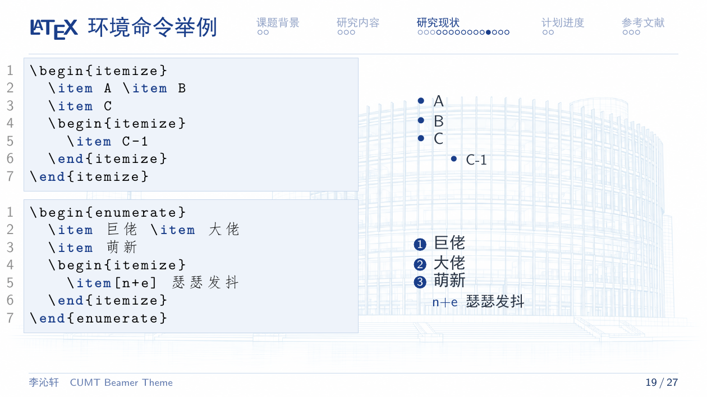
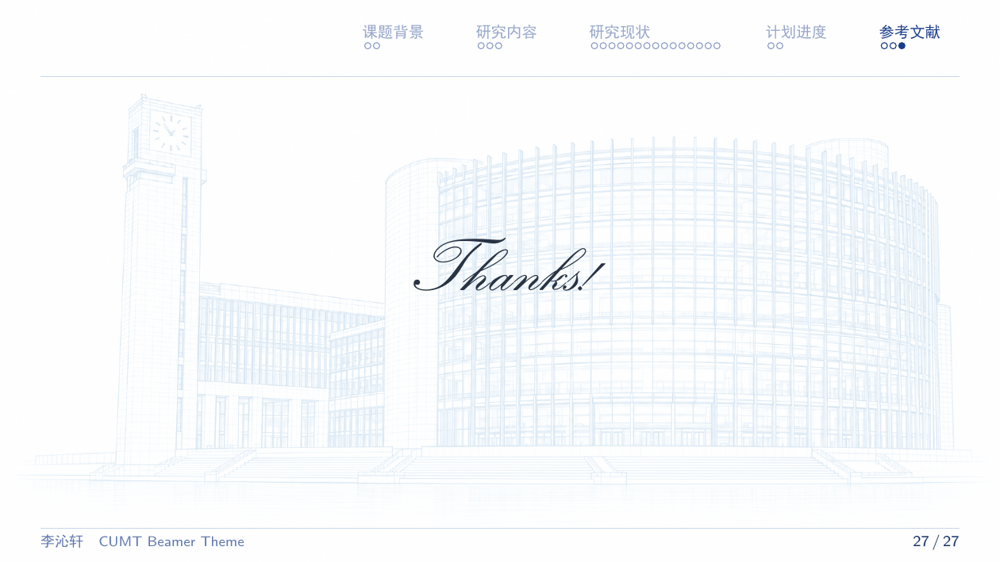

# CUMT Beamer Template | 中国矿业大学 Beamer 模板

一套以中国矿业大学校园建筑**白描线稿**为背景的 Beamer（LaTeX）演示模板，采用矿大蓝配色，输出 16:9 横版 PDF。支持手动编辑，也提供供 Claude Code、Codex 等 AI 工具使用的内容入口与模板保护规则。

**开始制作：**修改 [slide.tex](slide.tex) 中的报告信息和 [content.tex](content.tex) 中的正文，再使用 XeLaTeX 编译 **slide.tex**。正文文件中提供了公式、表格、代码与分栏等完整排版示例。

[效果预览 PDF](slide.pdf) · [AI 使用规则](AGENTS.md)

## 效果预览

| 封面 | 目录与章节导航 |
|:---:|:---:|
|  |  |

| 正文 | 致谢页 |
|:---:|:---:|
|  |  |

以上截图均由仓库中的 [slide.pdf](slide.pdf) 导出。

- **封面**：校门牌楼白描背景，配校名标准字
- **正文**：图书馆白描背景（低透明度衬底，不干扰内容）
- **致谢页**：淡蓝校门白描背景，衬线斜体 Thanks!、细分隔线与疏朗宋体致谢文案
- 顶部导航由 `\section` 自动生成；示例包含五个板块，可按报告内容修改
- 导航圆点每行最多 7 个，超出自动换行；左侧长标题自动适应可用宽度
- 校徽与校名提供 SVG / 矢量 PDF，封面与正文采用蓝白学术配色

## 为什么 2026 年了又把 LaTeX PPT 拿出来做？

说实话，以前手写 Beamer 又累又慢：一行一行敲代码，格式一点点调，做一份 PPT 的时间够用 PowerPoint 做三份。

现在可以让 **Claude Code、Codex 等 AI 编程工具协助填入内容、调整排版和编译检查**：

- 以前：手动敲 LaTeX、查语法、调格式，累且慢
- 现在：模板放进项目里，让 AI 读技术报告和代码，填入内容、调整排版，再检查编译结果

对懒人来说，Beamer 重新变成了做横版 PDF 演示的利器：版式精确、公式漂亮、版本可管理。所以我把它翻出来，重新优化了一遍。

## 相对原版模板的优化

在学长原版 CUMT Beamer 模板的基础上：

- 封面、正文、致谢页背景换成本校建筑的**白描线稿**（校门牌楼 + 图书馆），由 AI 生成 PNG；校徽与校名组合图描摹为矢量路径
- 重新设计配色（矿大蓝 `#1A3E8A`）、标题黑体、页眉导航与页脚样式
- 区块（block）、目录页、代码框等页面元素的样式优化
- 致谢页采用 TeX Gyre Pagella 衬线斜体英文与宋体中文，搭配细分隔线；缺少该英文字体时回退到 Latin Modern Roman
- 封面与致谢页封装为 `\CUMTMakeTitle` 和 `\CUMTMakeThanks`，替换文字时直接复用主题版式
- 入口与正文分离，配套 AI 编辑规则和模板完整性检查，方便保留校园视觉元素并专注修改内容

## 推荐工作流：让 AI 帮你做 PPT

1. 把本模板克隆到你的项目里（根目录或子文件夹均可）：

   ```bash
   git clone https://github.com/Richard110206/CUMT-Beamer-Template.git
   cd CUMT-Beamer-Template
   ```

2. 在项目目录打开 Claude Code（或 Codex 等 AI 编程工具），让它阅读你的代码和技术文档

3. 明确告诉 AI 使用哪一种模式。默认推荐**套用模板**：

   > 使用 CUMT-Beamer-Template 模板制作开题汇报。先读 AGENTS.md 和 README.md，以 slide.tex 为入口，只修改报告信息、致谢文案和 content.tex。保留 CUMT 与 CUMT-campus 主题、封面与致谢命令、顶部章节导航及圆点、页脚、校园白描背景和校徽。根据我的技术报告填入内容，执行模板检查，用 XeLaTeX 编译至辅助文件稳定，并检查 PDF。

4. AI 填好内容并自动编译，得到 16:9 横版 PDF —— 完工。

### 套用模板、重新设计、仅参考风格

| 模式 | 适合的指令 | 可修改范围 |
| --- | --- | --- |
| 套用模板（默认） | “用这个模板，把内容替换为我的报告” | 报告信息、章节与正文、业务插图、致谢文案 |
| 重新设计模板 | “修改模板的致谢字体，保留其他底板和导航” | 明确指定的主题设计范围 |
| 仅参考风格 | “不套用原模板，只参考矿大蓝，另建一份设计” | 在独立目录自由设计 |

“参考一下模板”容易让 AI 理解为只借鉴风格。需要保持原样时，使用“**套用模板，只替换内容**”，并把整个模板目录交给 AI，而不是只给 slide.tex。给网页聊天工具使用时，显式要求它先阅读 AGENTS.md；各工具对规则文件的自动加载方式不同。

模板把内容与视觉底板分开：slide.tex 是报告入口，content.tex 是正文；CUMT-campus.sty 统一管理导航、页脚、白描背景、封面及致谢版式。建筑图是模板的**校园白描插画底板**，不属于待清理的水印。正文/致谢页使用淡色处理以保证文字可读。

```latex
% 修改 slide.tex 中的报告信息即可更新封面
\title{你的报告标题}
\author{你的姓名}
% 修改致谢文字，不必复制或重写致谢页面
\renewcommand{\CUMTThanksEnglish}{Thanks!}
\renewcommand{\CUMTThanksChinese}{感谢聆听，敬请指正}
```

AGENTS.md 和 CLAUDE.md 给 AI 指明编辑边界，`check_template.py` 用 SHA-256 检查主题及其引用素材是否被修改或删除，并扫描常见的内容层主题覆盖。规则文件约束编辑范围，静态检查发现常见改动，最终通过 PDF 目视检查确认效果。这套流程属于交付核对，文件本身仍可编辑。脚本不会自动追踪 `\input`：增加内容文件后，请把入口和全部内容文件作为参数传入。

```bash
python check_template.py
# 自定义入口或拆分多个内容文件时：
python check_template.py slide.tex content.tex extra-content.tex
```

输出 PDF 前检查封面白描与校徽、正文导航及底板、致谢白描与文字是否齐全。只有明确修改主题时才更新 template-lock.json；填内容时不要通过更新锁文件消除检查失败。

## 编译方法

本地环境需要 TeX Live 或 MiKTeX，包含 Beamer、ctex、TikZ 等宏包；运行检查脚本另需 Python 3（仅用标准库）。

中文模板，**使用 XeLaTeX 编译**，至少编译两遍（生成目录与导航）。首次编译新报告或更改章节结构后，如日志仍提示 `Label(s) may have changed`，继续编译直到提示消失；TikZ 白描底板和致谢文字的绝对定位也依赖辅助文件稳定，首次通常需要三遍。

在模板根目录运行以下命令。示例正文包含参考文献，因此首次编译时运行一次 BibTeX；后续仅修改正文时通常直接运行 XeLaTeX 即可，修改引用后再运行 BibTeX。

```bash
python check_template.py
xelatex -interaction=nonstopmode -halt-on-error slide.tex
bibtex slide
xelatex -interaction=nonstopmode -halt-on-error slide.tex
# 首次编译新报告，继续一遍以稳定导航与背景定位：
xelatex -interaction=nonstopmode -halt-on-error slide.tex
```

也可以把完整模板目录上传到 [Overleaf](https://www.overleaf.com)，选择 XeLaTeX 编译器，将主文档设为 **slide.tex**。content.tex 由入口自动载入。

### 常见问题

- **顶部章节或圆点没有更新：**保留 `\section{章节名称}`，正常正文使用 `frame`，并继续编译到辅助文件稳定。
- **背景或致谢文字缺失、位置异常：**确认整个 `pic/` 目录已复制，运行模板检查，再继续编译；首次出现定位异常时通常需要第三遍。
- **只想替换封面或致谢文字：**修改 slide.tex 的报告信息和两个致谢文案命令；页面布局由主题统一生成。
- **确实需要更换导航或背景：**明确选择“重新设计模板”并指定范围，完成后同步预览与 template-lock.json。

## 文件结构

```
slide.tex                    # 唯一编译入口：报告信息、封面、目录、正文调用、致谢
content.tex                  # 章节与正文，附完整排版示例，供用户 / AI 编辑
AGENTS.md                    # AI 编辑边界与三种使用模式
CLAUDE.md                    # Claude 工具的规则入口
check_template.py            # 主题素材完整性与常见覆盖检查
template-lock.json           # 受保护文件的 SHA-256 清单
CUMT.sty                     # 基础主题：颜色、字体
CUMT-campus.sty              # 校园白描背景主题（当前使用）
pic/                         # 图片素材（白描背景、校徽、预览图）
ref.bib                      # 参考文献示例
slide.pdf                    # 唯一 PDF 预览，修改源码后重新编译生成
```

## 致谢

- 感谢学长提供的原版 CUMT Beamer 模板
- 白描背景图由 AI 生成，[pic/](pic/) 目录内附生成说明
